<table>
<tr>
<td align="center" valign="top">

</td>
<td align="center" valign="top">
<b>My favorite used language: <code>Java</code></b> 
 
</td>
</tr>
</table>

<!-- cool-readme:start -->
<!-- Cards by github-cool-readme: https://github.com/pedrocatalao/github-cool-readme -->

<picture>
  <source media="(prefers-color-scheme: dark)" srcset="https://raw.githubusercontent.com/twoods63/twoods63/cards/summary-dark.svg">
  
</picture>
<picture>
  <source media="(prefers-color-scheme: dark)" srcset="https://raw.githubusercontent.com/twoods63/twoods63/cards/languages-dark.svg">
  
</picture>

<picture>
  <source media="(prefers-color-scheme: dark)" srcset="https://raw.githubusercontent.com/twoods63/twoods63/cards/about-dark.svg">
  
</picture>
<picture>
  <source media="(prefers-color-scheme: dark)" srcset="https://raw.githubusercontent.com/twoods63/twoods63/cards/contributions-dark.svg">
  
</picture>

<!-- cool-readme:end -->
